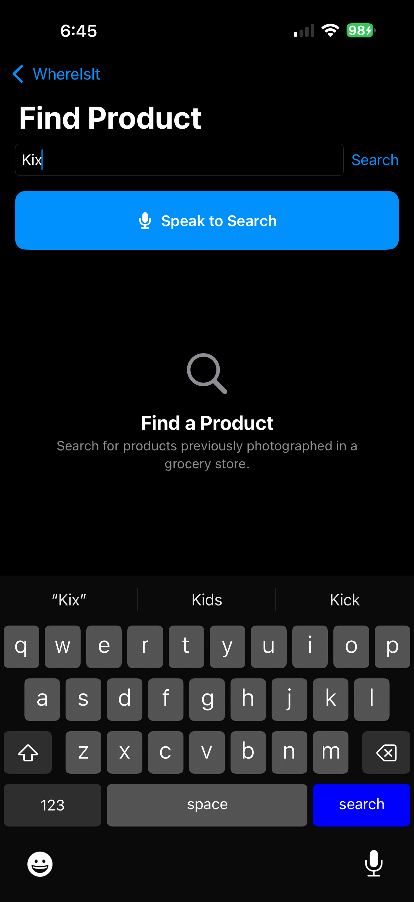
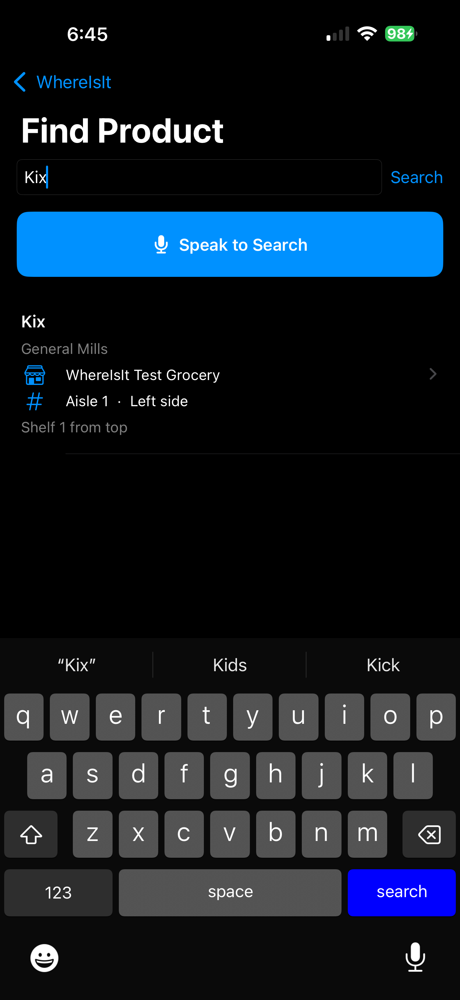
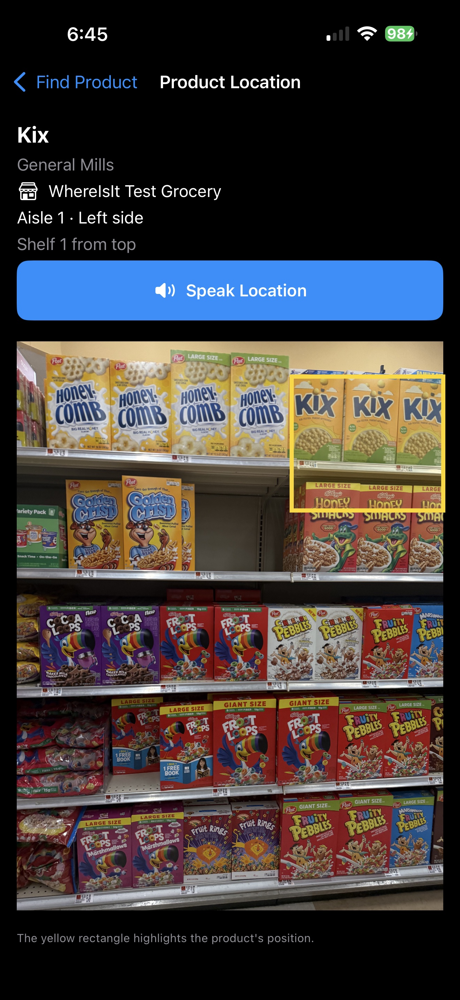

# WhereIsIt
### Making grocery shopping more accessible through AI and crowdsourced product locations

**WhereIsIt** is an iOS application designed to help shoppers—particularly people with low vision—find products on grocery store shelves.

Traditional grocery store directories may identify an aisle, but they rarely tell shoppers exactly where a product is located within that aisle. WhereIsIt addresses this problem by combining artificial intelligence, crowdsourced shelf photographs, and accessible navigation tools.

## Screenshots

The following screenshots demonstrate the product-search
workflow in WhereIsIt.

| Find Product | Search Result | Product Location |
|:---:|:---:|:---:|
|  |  |  |
| Search for a grocery product | Find its aisle and shelf | View its location in a shelf photograph |

## How It Works

WhereIsIt has two primary workflows:

### 1. Contribute Shelf Information

Users photograph grocery store shelves and identify the store, aisle, and shelf side.

The application sends the photograph to an AI recognition service, which identifies visible products and their positions in the image.

Users can review, correct, or remove the AI-generated identifications before submitting them.

Verified product observations and shelf photographs are stored in a shared database, making them available to other shoppers.

### 2. Find a Product

Users search for a grocery product by name or brand.

WhereIsIt retrieves available product locations and displays information such as:

- Store
- Aisle
- Shelf side
- Shelf number or position
- Original shelf photograph

The application can display the photograph with the product's estimated location highlighted, helping users identify the correct item.

## Accessibility First

Accessibility is a central design goal rather than an additional feature.

WhereIsIt incorporates:

- **Voice search:** Users can speak product names instead of typing.
- **Spoken locations:** Product location information can be read aloud.
- **VoiceOver support:** Navigation is designed to work with Apple's screen reader.
- **Adjustable text sizes:** Users can choose larger in-app text.
- **Display preferences:** Support for light and dark appearance.
- **Visual shelf references:** Photographs help communicate product placement beyond an aisle number.

The project explores how computer vision and accessible interface design can work together to make everyday environments easier to navigate.

## Technical Architecture

| Component | Technology |
|---|---|
| Mobile application | Swift, SwiftUI |
| Platform | iOS |
| Authentication | Supabase Auth |
| Database | Supabase PostgreSQL |
| Photograph storage | Supabase Storage |
| Backend processing | Supabase Edge Functions, TypeScript |
| AI recognition | OpenAI GPT-5.4 |
| Speech input | Apple Speech framework |
| Speech output | AVSpeechSynthesizer |
| Accessibility | VoiceOver, scalable text, display settings |

### Image Recognition Pipeline

1. A user captures or selects a shelf photograph.
2. The application sends the photograph to a Supabase Edge Function.
3. The Edge Function calls an OpenAI model to recognize products and estimate their locations within the photograph.
4. The application presents the recognition results for human review.
5. Approved observations are saved to PostgreSQL.
6. The shelf photograph is stored in a private Supabase Storage bucket.
7. Other authenticated users can search for the products and retrieve linked photographs.

### Backend and Data Model

The backend maintains information about stores, products, shelf photographs, and individual product observations.

PostgreSQL views support location searches, while Row Level Security and Storage policies control access to records and images.

The repository includes source code for the Edge Functions and SQL exports of the database structure. **The SQL files are development snapshots and have not yet been validated as a complete fresh-install migration sequence.**

## Project Structure

```text
WhereIsIt/
├── WhereIsIt/                 # SwiftUI application
├── WhereIsIt.xcodeproj/       # Xcode project
├── supabase/
│   ├── functions/
│   │   ├── recognize-products/
│   │   └── save-observations/
│   └── migrations/           # Database and Storage SQL
├── PROJECT_HANDOFF.md         # Development handoff notes
└── README.md
```

## Current Development Status

WhereIsIt has a working iPhone prototype supporting the complete workflow from photographing a shelf to identifying, saving, searching for, and locating grocery products.

Implemented capabilities include AI-assisted recognition, human review, shared product observations, photograph retrieval, voice search, spoken locations, VoiceOver compatibility, and text-size preferences.

### Ongoing Development

Areas for further improvement include:

- Improving the accuracy of product bounding boxes in crowded shelf photographs.
- Refining product matching and search results.
- Strengthening privacy and security controls for broader deployment.
- Expanding store coverage and crowdsourced observations.
- Additional accessibility testing with users who have low vision.
- Validating database migrations and documenting reproducible deployment steps.

## Why This Project Matters

Finding a particular product in a busy grocery aisle can be challenging when packaging is difficult to read or visually distinguish.

WhereIsIt approaches this challenge as both an engineering problem and an accessibility problem: how can AI identify products reliably, how can people correct imperfect results, and how can that information be presented in a form useful to shoppers with different visual abilities?

The project brings together mobile software development, cloud infrastructure, computer vision, database design, and accessibility engineering.

## Development and Availability

WhereIsIt is an experimental prototype under active development, not a production-ready consumer service.

The source code is available for educational and portfolio purposes. Running a separate instance requires configuring an independent Supabase project, backend environment variables, database permissions, and OpenAI API access.

**API secrets and private credentials are not included in this repository.**